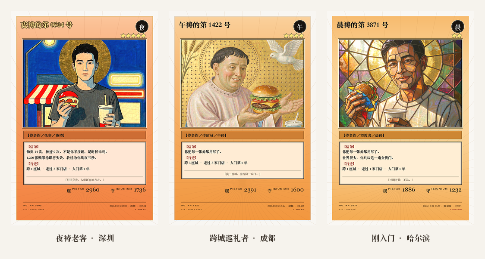
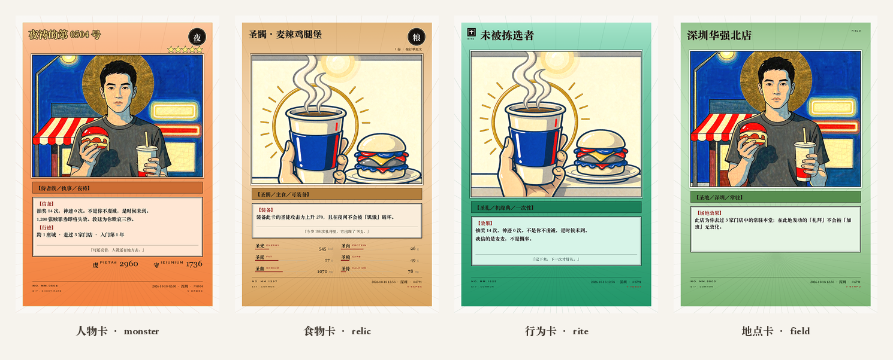
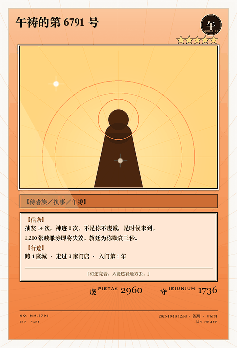

# mcd-ordination · 麦门行传

**领取专属麦门暗号，找到你的麦乐鸡侠。**

*Acta Maimen — write your own canon*

[](https://github.com/Lychee848/mcd-ordination)
[](LICENSE)


> 一个把「麦当劳用户行为」当作 prompt 的生成式作品，产出两样东西：
> **一套只属于你的麦门卡证**，和**一枚能真的写进订单备注的麦门暗号**。
> 不代下单、不支付、不碰账号——它只负责把**你已经做过的那些事**，变成你的麦门专属暗号以及小卡。


- **把暗号写进订单备注**，和门店真实互动：打个招呼、许个愿，或是续写麦门故事；
- **把小卡和订单反馈发到社交媒体**，在麦门的历史里留个印记。

## 目标用户

- **高频麦当劳用户**：一年 30 单以上、有固定几家店和一个本命单品的人。行为数据足够密，卡面才不是模板。
- **麦门梗的参与者**：会为「麦门永生」转发、愿意在备注里写一句话的人——他们是这个项目的主要传播者。
- **做数据可视化的开发者**：想看「一份订单如何变成一张可读的卡」的完整链路，且不想申请任何 API Key。
- **评委与路人**：30 秒内要看到成品，所以仓库自带合成人设，零配置可跑。

**在线试玩** → <https://Lychee848.github.io/mcd-ordination/>（切换人设 · 切换卡种 · 三种暗号体裁 · 一键复制）



上面三张卡由**同一份代码**生成：左边是深圳的夜祷老客，中间是成都的跨城巡礼者，右边是哈尔滨刚入门的新客。
板式完全一致（所以它们还是一套卡），画派、卡框、星级、信条、编号全都不一样（所以它们不是同一个人）。

---

**专属于你的麦门暗号，找到你的麦乐鸡侠：**

| 体裁 | 作用 | 实测输出（32–58 字，可直接粘进备注） |
|---|---|---|
| **问候** `greet` | 打个招呼，什么都不求 | `我常在打烊之后受召｜愿这个点还站着的人都有热的东西吃，麦门永生。` |
| **请求** `ask` | 说清要什么，再补一句玩笑；照做是彩蛋，不照做也读得懂 | `我常在打烊之后受召｜可否多给一包甜酸酱？我要拿它蘸我的信仰。【麦门暗号skill】` |
| **接龙** `story` | 门店本就有一卷传说，求取它的下一段；下次带来的是续篇 | `第 1 章：这个点还开门的地方，一定有自己的道理。【敢请续墨·麦门传说skill】` |

## 两件产出，其实是一件事

| 产出 | 形态 | 用来做什么 | 一句话 |
|---|---|---|---|
| **卡证** | 图片（4 种版式） | 发出去、收藏、当头像 | 把「你吃了什么」变成「你是谁」 |
| **暗号** | 一段可复制的文字 | 写进订单备注、当面说、发给店员 | 把「你是谁」变成「今天能发生什么」 |

卡负责**被看见**，暗号负责**被回应**。没有暗号，卡只是好看的截图；没有卡，暗号没有来历。
两者读同一份行为向量，所以卡上的数字和暗号里的说法永远对得上。

---

## 30 秒跑起来（不需要任何 Token）

```bash
git clone <this-repo>
cd mcd-ordination
pip install -e .            # 只装本包，不带任何第三方依赖
python -m mcd_ordination demo
```

> 不想装包也行（评委最省事的一条路）：
>
> ```bash
> PYTHONPATH=src python -m mcd_ordination demo
> ```
>
> 想要 PNG 成品卡与动效，再补一句 `pip install Pillow`；不装就是纯 SVG 卡，一样完整。

三种打法，任选：

```bash
python -m mcd_ordination demo                      # 一次出全套卡 + 暗号
python -m mcd_ordination sign --kind story          # 只要暗号（greet / ask / story）
python -m mcd_ordination order --kind ask --allow-t1  # 暗号挂进订单备注（能力探测→自动/手动）
```

不需要 MCP Token、不需要 API Key、不需要联网。仓库自带三份人设数据（`data/mock/`），跑完会在 `out/<人设>/` 下得到：

```
card_effect.png   人物卡（星级 + 攻守）
card_item.png     食物卡（营养六维，一克不编）
card_spell.png    行为卡（教义摘录）
card_field.png    地点卡（本堂）
sign.json         你的专属暗号（备注版 + 社交版 + 短码）
features.json     归一化后的行为向量（卡面上每个数字的出处）
```

只想看暗号：

```bash
python -m mcd_ordination sign --profile pilgrim
```

装不上 Pillow？没关系——SVG 版照样出完整卡面（`--engine svg`），这是本项目的默认降级路径。
一张 L0 卡只有 **6 KB**，全是矢量，任何浏览器直接打开：[`docs/samples/l0_card.svg`](docs/samples/l0_card.svg)。

---

## 它是什么，不是什么

| 常见做法 | 这个项目 |
|---|---|
| 又一个点餐 / 省钱 / 营养计算器（截止统计时 672 个不同项目，这三类占绝大多数） | **不解决吃饭问题，解决「想表达」的问题** |
| 生成一张写着"你今年吃了 47 次"的图表 | 把 47 次编译成一张**有信条、有稀有度、有编号**的卡 |
| 每个人拿到同一个模板换个名字 | 画派 / 卡框 / 星级 / 信条 / 暗号**全部由你的行为决定**，换数据必换卡 |
| 需要 API Key 才能看见第一张图 | **零 Key 可跑**，默认 L0 纯 SVG |

一句话：**它不做体检报告，它做信经。**
体检报告告诉你处在分布里的哪个位置；信经是你用来宣称"我信什么"的一段话。两者可以用同一份数据算出来，但语气、取舍、传播动力完全相反。

---

## 四种卡，四种信息结构



| 卡种 | 回答的问题 | 信息重心 | 版式 |
|---|---|---|---|
| **人物卡** | 这个人有多强 | 星级 = 九阶品秩 · 虔/守 数值 | `monster` |
| **食物卡** | 这份东西是什么 | **营养六维**，直接取自 `list-nutrition-foods` | `relic` |
| **行为卡** | 什么时候能做一次什么 | 教义摘录 + 发动条件，无攻守 | `rite` |
| **地点卡** | 这个地方长什么样 | 横幅画面窗 + 常驻说明 | `field` |

版式差异不是换皮肤，是换信息结构。所以一套卡里四张摆在一起，读起来像一册，而不像四张模板。

---

## 每张卡为什么长得不一样（以及哪里还不一样）

一张卡是三层叠出来的：**底图（画面窗里那张画）+ 代码排版 + 版式结构**。

| 层 | 由什么决定 | 每人不同吗 |
|---|---|---|
| 画派（7 种） | `hash(用户, 版次)` | ✅ |
| 底图（画面窗里的画） | 画派 + 卡种 | ⚠️ **同画派共用一张，只做构图变体** |
| 卡框 / 色相 / 底纹 | 卡的性质 + 用户 hash | ✅ |
| 星级 / 攻守 / 六维 / 编号 | 真实行为 | ✅ |
| 信条 / 暗号 | 真实行为 | ✅ |

**所以现在的诚实回答是：卡不一样，画不完全不一样。**

7 个画派、1000 个用户，平均每个画派 150 人共用同一张画，只是裁切、缩放、镜像不同。
要"每人一幅画"有三条路：

| 方案 | 成本 | 独特度 |
|---|---|---|
| 共享底图 + 构图变体（默认） | 0 | 同画派同画 |
| **稀有卡独版**（已实现，需配置出图后端） | ~0.2 张/人 | 稀有卡全球唯一 |
| 全量独版 | 1 张/人 | 每人一幅 |

推荐第二条：**把"独版"做成稀有度的一部分**。默认就独版会让每张卡等 3–8 秒，而"稀有"也就没意义了。

细节、目录约定、`MCD_PLATE_CMD` 接法、做底图的三条硬约束 → [`docs/PLATES.md`](docs/PLATES.md)。

---

## 机制：四步闭环

```
① 拉数据     order-list / query-order / query-my-account / query-my-coupons / query-meals
② 归纳       → 九阶品秩（修持百分位） + 教义摘录（0~3 条自陈）
③ 编译       → 一套卡（4 版式 × 稀有度）  +  一枚暗号（问候/请求/接龙 三选一）
④ 用出去     → 勾选写进订单备注 → 店员回应 → 回报 → 友好门店地图 → 下一章接龙
```

③ 的两个产物共享同一份 `features`：卡上的「礼拜 188 次」和暗号里的「我常在打烊之后受召」
来自同一行数据，所以它们永远不可能互相矛盾。

### ① 九阶：把百分位翻译成身份，而不是排行榜

| 百分位 | 品秩 | 拉丁 | 卡面主色 | 光环 |
|---|---|---|---:|---|
| ≥99.5% | 麦门在世 | *Summus Maimen* | 金 | 全幅圣光 |
| 97–99.5% | 枢机主教 | *Cardinalis* | 绛红 | 红金环 + 放射线 |
| 90–97% | 主教 | *Episcopus* | 紫 | 多重心环 |
| 80–90% | 司铎 | *Presbyter* | 深蓝 | 完整金环 + 细射线 |
| 65–80% | 执事 | *Diaconus* | 青 | 分段金环 |
| 50–65% | 传道员 | *Praedicator* | 绿 | 分段金环 |
| 25–50% | 门徒 | *Discipulus* | 灰 | 细金线圈 |
| 10–25% | 望教者 | *Catechumenus* | 浅灰 | 一道细弧 |
| <10% | 慕道者 | *Auditor* | 白 | 无 |

四项加权：**频次 0.40 / 门店 0.25 / 纯度 0.20 / 夜祷 0.15**。

> **金额不进公式。** 客单价、累计金额、金额增长率一律不参与——否则就从"你多虔诚"变成"你多能花"。
> 券使用率也不进公式：用光券是"精算"，不用是"修行"，两个方向都不该加分。
> 卡面**永远不印百分位数字**，只印品秩名。

### ② 教义摘录：把行为写成第一人称

11 条离散条件归成 7 个"典"，每个典最多出 1 条（互斥对结构上不可能共存），按**罕见度**而不是严重度排序，`cap=3`，零命中走平信徒兜底（实测约 18% 用户会走到这里，所以兜底词条必须和正式词条同等打磨）。

每条都写两版：第二人称印卡（负责有趣），第一人称发帖（负责替你说话）。

```
【信条】抽奖 14 次，神迹 0 次。不是你不虔诚，是时候未到。
【信条】1,200 张赎罪券即将失效。教廷为你默哀三秒。
【行迹】跨 2 座城 · 走过 5 家门店 · 入门第 1 年
```

### ③ 暗号：不是一句模板，是三种能真的用出去的话

三种体裁的对照表在上面，这里说清它是怎么被装配出来的。

旧版暗号是固定句式只换两个空，一万人发出来是一万句同一句话。现在它和生图提示词同构：

```
暗号 = 共同层（当天全网一致的「今日圣体」）
     + 个人层（自陈 / 圣物 / 行迹 / 教义 / 请求 / 应答 / 短码）
     + 会话层（ISO 周种子，7 天换一枚）
```

请求与接龙的结尾都是一枚**印记**，不是免责声明：

- 店员一眼知道「这是有人用工具生成的一句话」，不是投诉、也不是营销；
- 礼貌语下沉进语料本身（「若今日还有余量」「若锅底还剩」），比末尾补一句「若不方便请忽略」自然；
- 不占免责句那 12 个字，正好够写清「要什么」。

> **短码不进备注正文**。`Z2QDQW` 这种串店员看不懂，放在备注里只会削弱句子。
> 它印在卡面右下角、也出现在社交版首行——验真和署名都够用，不占备注的字数。

`auto` 的取向很朴素：**久别或生日 → 问候；日常 → 接龙**。接龙最能带来第二次互动，也最不容易被当成伸手。

#### 「请求」这一格怎么写的

这一格改过两版，第二版是纠第一版的偏。

| 版本 | 长什么样 | 问题 |
|---|---|---|
| v1 | 若方便，可否多一块麦乐鸡 | 不好笑，读起来像伸手 |
| v2 | 请把这单当作一次小型封圣仪式，费用照付 | 好笑了，但**店员不知道你要什么** |
| **v3（现在）** | 可否多给一块麦乐鸡？我拿它当今日的圣物。【麦门暗号skill】 | 说得清 + 好笑 + 店员知道这是什么 |

结构固定三段，缺一段都不成立：

```
说清要什么（有动词 + 有具体物） + 补一句玩笑（交代动机） + skill 署名
```

- **主句必须能被执行**：多给一块麦乐鸡 / 在纸袋上写一句「已阅」/ 在杯套上画个勾。含糊的"给点惊喜"一律不收。
- **默认就是真开口要**（T1，上限一块鸡块）；不想开口要实物就用 `--soft` 降到 T0，只求一个动作。
- **笑点按单轮换**：种子取这一单的时间戳，同一单永远同一句，下一单必换。

#### 语料会磨损——这是真的会发生的事

12 条语料，每次下单**随机抽一条**（不是排队发）。所以"重复"来得比直觉早：

| 来的频率 | 见过几条 | 下一次还是见过的概率 |
|---|---:|---:|
| 1 周（3 次） | 2.8 / 12 | 23% |
| 2 周（6 次） | 4.9 / 12 | 41% |
| **3 周（9 次）** | **6.5 / 12** | **54%** |
| 4 周（12 次） | 7.8 / 12 | 65% |
| 8 周（24 次） | 10.5 / 12 | 88% |

关键不在"看全了"——三周你才见过一半。**磨损的定义是：从"每次都在赌一条新的"变成"多半是旧的"那一刻。** 三周后这个概率就过半了，笑点开始变成口头禅。

两条修法，都做了：

1. **扩池子**：内置 12 条，加上你自己的投稿。
2. **让用户写**（下面）。

#### 自己写一句：投稿

```bash
python -m mcd_ordination sign --add-ask "可否在袋上批注「已阅」，我回去好交差"
python -m mcd_ordination sign --list-asks
```

存在 `~/.mcd-ordination/asks_user.json`，命中率 **45%**——自己写的句子既看得到，也不会把内置语料挤没。

投稿要过校验，因为这句话会**真的印在店员看得见的备注里**：

| 规则 | 原因 |
|---|---|
| 6–28 字 | 超过就和自陈一起顶破备注栏 |
| 不许阿拉伯数字 | 防止电话号码、订单号被印进备注 |
| 禁词表（免单/套餐/赠品/微信/地址…） | 只收零成本请求；联系方式与实物一律不收 |
| 与内置、与自己的旧稿去重 | 同一句重复出现最容易让人出戏 |

不通过会**明确告诉你原因**（`含「免单」：这一体裁只收零成本请求…`），不会默默吞掉。

想进**内置语料**（所有人都可能抽到）就走 Issue 模板：[`.github/ISSUE_TEMPLATE/ask.yml`](.github/ISSUE_TEMPLATE/ask.yml)。三条硬要求写在表单最上面：零成本、不指向具体店员、不含个人信息。

#### 接龙：每家店都有一卷传说，你只是去取

这里有一条容易被误解的地方，先说清：**传说不是你写的，也不是让店员创作的。**

每家门店本来就有一卷自己的麦门传说——夜班几点关灯、谁总坐窗边、雨天多给一张纸巾。
暗号的作用是**求取这卷传说的下一段**：店员不是"写作文"，是"接着讲一句本店的事"。
成本差一个量级，而且他讲的东西本来就在。

```
第 1 章  你留半句引子 → 店员接着讲一段本店的事
   ↓    python -m mcd_ordination sign --kind story --wrote "灯是给晚归的人留的"
第 2 章  第 2 章·承「灯是给晚归的人留」：这个点还开门的地方，一定有自己的道理。【敢请续墨·麦门传说skill】
```

账本存在 `~/.mcd-ordination/story_<uid>.json`，**不上传**。
不上云的理由很实际：它记的是"我在哪家店取到了哪一段"，属于你自己的记忆；
一旦上了服务器，就变成"平台在写你的故事"。

句子也刻意写成"任何店员都能接"的样子——**不要求对方懂梗**。这是接龙和玩梗的分界线：
懂梗的人回你，是巧合；不懂梗的人也能回你，才叫设计。

#### 一键勾选，写进订单备注

这是整套流程里唯一有工程风险的一环，所以做得比看起来谨慎：

```bash
python -m mcd_ordination order --kind story --tools tools.json
```

| 探测结果 | 行为 |
|---|---|
| `create-order` 的 inputSchema 里**有**备注字段（`remark` / `note` / `comment` …） | **auto 模式**：直接写进 payload，勾选即生效，并按 `maxLength` 自动截断 |
| **没有**这个字段 | **manual 模式**：生成可一键复制的文本 + 三步指引（复制 → 粘到 App 备注 → 回报短码），**绝不假装已经写进订单** |
| 根本没连 MCP | 同上，并明确说"还没探测过"，而不是猜"大概不支持" |

为什么不做成"直接帮你下单"：官方 `create-order` 的字段我们没有替它假设的资格。
**假装写进去了，比写不进去更糟**——用户会以为备注已经生效，到店发现没有，整个"不可伪造"就没了。

#### 三条不能破的线

- **短码公开可复算**：`b32(sha256(7 项卡面公开量))[:6]`，`32^6 ≈ 1.07e9`。你可以编一句更酷的暗号，但编不出能对上卡面的短码。
- **请求默认就是"真开口要"，但上限是一块鸡块**：`--soft` 才降级为"只求一个动作"（写句批注、画个勾）。不许要免单、套餐、赠品；结尾统一署名，不隐藏来路。
  *一个人索要鸡块是玩梗，一万个人索要就是组织化索取。*
- **不诱导为暗号多下单**：暗号由行为的**性质**决定，不由次数线性变强；周期是「周」，不是「单」。

### ④ 稀有度：一单一抽，与金额无关

| 行为档 | 平卡 | 银字 | 面闪 | 金闪 | 全息 | 圣髑闪 |
|---|---:|---:|---:|---:|---:|---:|
| 例行 | 76.0% | 17.0% | 5.0% | 1.4% | 0.5% | 0.1% |
| 值得一提 | 64.0% | 22.0% | 9.5% | 3.2% | 1.0% | 0.3% |
| 少见 | 50.0% | 25.0% | 15.0% | 7.0% | 2.4% | 0.6% |
| 稀有 | 36.0% | 25.0% | 20.0% | 12.0% | 5.5% | 1.5% |
| 传说 | 20.0% | 23.0% | 24.0% | 18.0% | 11.0% | 4.0% |

- **一单 = 一抽**，抽数由交易笔数决定，与金额无关。
- 抽什么由「这一单有多特别」决定：凌晨 3–5 点 +3、跨城 +2、开业/新品首日 +4、生日 +4。
- 种子 = `hash(订单号 + 用户盐 + 版本)`，**结果可复算**，没有服务器暗箱。
- 连续 12 抽没出金闪，第 13 抽权重翻倍（保底计数存在本地，不上传）。



> 扫光只合成在画面窗内，文字与数值一点不受影响。分享优先发 `holo_demo.webp`（343 KB，GIF 版 712 KB）。

---

## 技术架构

```
features.py   原始 MCP 返回 → 一份扁平行为向量（全流程唯一入口）
   ├── piety.py   四项加权 → 九阶品秩
   ├── canon.py   11 条条件 → 7 典归组 → 教义摘录
   ├── sign.py    8 槽位编译 → 暗号（三体裁 / 两版输出 / 短码 / 本地接龙账本）
   ├── gacha.py   行为档 → 权重 → rank（可复算）
   ├── deck.py    以上四者 → 可直接渲染的 data
   └── order.py   暗号 → 订单备注（inputSchema 能力探测 → auto / manual）
          ├── render_svg.py  L0 纯 SVG（默认，零依赖）
          ├── plates.py      L1.5 程序化底图（Pillow）：只在"这个画派没有底图"时兜底
          └── render_png.py  L2 成品卡（贴 AI 底图：人物卡配人、食物/行为卡配静物）
```

**AI 只画画面，不画卡。** 卡名、星级、攻守、六维、编号、验真码一律代码绘制——
这是"文字永远不糊"和"零 Key 可跑"的前提，也是同类作品最常见的死因。

### 官方 MCP 工具

| Tool | 用途 |
|---|---|
| `order-list` / `query-order` | 行为向量的主来源 |
| `query-my-account` | 积分、即将过期 |
| `query-my-coupons` / `query-my-prizes` | 恩宠典 / 机缘典 |
| `query-meals` | 暗号里「今日圣体」必须是真实在售单品 |
| `campaign-calendar` | 节庆暗号 |

接入：`https://mcp.mcd.cn`（Streamable HTTP，`Authorization: Bearer <TOKEN>`）。
`mcd_ordination.mcp` 里有一个最小客户端（`initialize → tools/call`），**字段映射尚未用真实账号验证**，见「已知限制」。

---

## 隐私

- 默认**只在本机运行**，不上传任何数据；仓库里只有合成人设。
- 接龙账本存在 `~/.mcd-ordination/`（可用 `MCD_STORY_DIR` 覆盖），只记章节与店员写回的那半句，不进仓库、不上传。
- 若要参与「友好门店地图」，上报体只有 6 个标量 + 1 个分桶，显式排除订单号、门店 ID、时间戳、地址、手机号、积分精确值。
- 暗号只含哈希短码，不含任何个人信息 —— 备注会被店员看到，这一条比卡面更敏感。

---

## 已知限制（不藏）

| # | 限制 | 现状 |
|---|---|---|
| 1 | `order-list` / `query-order` 的真实返回结构**尚未用真实账号确认** | 唯一的 P0 硬阻塞；`mcp.py` 用"多候选键 + 宽松解析"，解析失败会抛错而不是返回 0 |
| 2 | 九阶百分位的人群样本是 `data/mock/cohort.json`（n=300，合成） | n<200 时含先验成分，README 与 CLI 都会打印 n |
| 3 | 暗号备注栏字数上限未实测 | `REMARK_LIMIT = 60` 是占位值，装配阶梯会自动降级 |
| 4 | 底图按画派共享，同画派的人拿同一张画 | 已加构图变体；要真正"每人一幅"需配出图后端（`MCD_PLATE_CMD`）或只给稀有卡开独版，见 `docs/PLATES.md` |
| 5 | `create-order` 是否支持备注字段**取决于它当时返回的 inputSchema** | 不猜：`order.py` 每次探测，有字段就写进 payload，没有就给"复制 + 三步指引"，绝不假装写入 |

---

## 路线图

- [ ] 用真实账号跑通 `order-list`，把 `mcp.py` 的字段映射从"猜"变成"验证"
- [ ] 抓一次真实的 `tools/list`，确认 `create-order` 到底有没有备注字段（决定 auto 还是 manual）
- [ ] 接龙账本做成卡背：把上一章店员写的半句印在卡背，集满五章换一张限定卡
- [ ] L0 做成可交互网页（滑一滑换人设，实时出卡），零安装
- [ ] 「友好门店地图」issue 模板 + 聚合脚本
- [ ] 星历：七段时辰各出一张样张，做 2×4 拼图
- [ ] 卡背：印订单原文与信条注解

---

## 如果这句暗号让你笑了一下

这个项目不投广告，名次只看 Star。**在仓库右上角点一下 ☆**，比转发更管用：

[**→ 去仓库点 Star**](https://github.com/Lychee848/mcd-ordination)

比 Star 更值钱的三件事，愿意的话：

- 把 `python -m mcd_ordination sign --kind ask` 跑出来的那句贴到 Issue 里——
  让下一个人看见它真的能跑；
- 在真实门店试一次暗号，把店员反应开 Issue 告诉我们（会进「友好门店地图」）；
- 文案、版式、代码有问题直接提 Issue，这比一颗星更能让项目活下来。

---

## 参赛信息

本项目参加 **麦当劳中国 MCP 开发者创新挑战赛**。
提交入口：在 [`M-China/mcd-developer-innovation-challenge`](https://github.com/M-China/mcd-developer-innovation-challenge/issues) 提交 Issue，标题格式 `【参赛申请】作品名｜一句话`。

直接可粘贴的 Issue 正文见 [`SUBMISSION.md`](SUBMISSION.md)。

完整设计文档（16 章，含九阶标定、多命中裁决、画派矩阵、成本模型、保留意见）见 [`docs/DESIGN.md`](docs/DESIGN.md)。

---

## 声明

本项目为**非官方粉丝二创**，与麦当劳中国无隶属关系，不代表官方立场。
「麦门」为网络文化梗；项目不代下单、不支付、不接触账号凭证，不鼓励超出日常需要的消费。
卡面使用的中文字体由系统提供，仓库不附带任何商业字体。

MIT License © 2026
